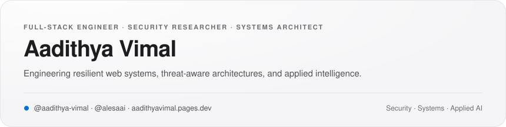
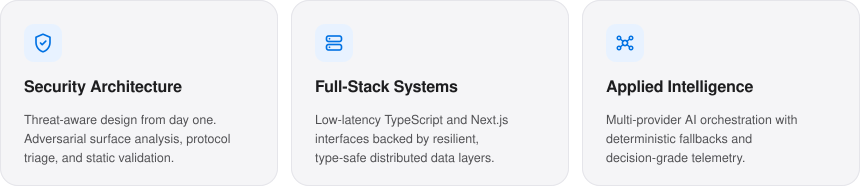

<!-- Identity -->
<a href="https://aadithyavimal.pages.dev">
  <picture>
    <source media="(prefers-color-scheme: dark)" srcset="./assets/hero-dark.svg" />
    <source media="(prefers-color-scheme: light)" srcset="./assets/hero-light.svg" />
    
  </picture>
</a>

  

<!-- Core Focus -->
<picture>
  <source media="(prefers-color-scheme: dark)" srcset="./assets/focus-dark.svg" />
  <source media="(prefers-color-scheme: light)" srcset="./assets/focus-light.svg" />
  
</picture>

  

<!-- Engineering Telemetry -->
<a href="https://github.com/aadithya-vimal">
  <picture>
    <source media="(prefers-color-scheme: dark)" srcset="https://github-profile-summary-cards.vercel.app/api/cards/profile-details?username=aadithya-vimal&theme=github_dark" />
    <source media="(prefers-color-scheme: light)" srcset="https://github-profile-summary-cards.vercel.app/api/cards/profile-details?username=aadithya-vimal&theme=default" />
    
  </picture>
</a>

 

<table width="860">
  <tr>
    <td width="50%" align="center">
      <picture>
        <source media="(prefers-color-scheme: dark)" srcset="https://github-stats-extended.vercel.app/api?username=aadithya-vimal&show_icons=true&count_private=true&bg_color=141416&title_color=F5F5F7&icon_color=0A84FF&text_color=A1A1A6&border_color=2C2C2E&border_radius=14" />
        <source media="(prefers-color-scheme: light)" srcset="https://github-stats-extended.vercel.app/api?username=aadithya-vimal&show_icons=true&count_private=true&bg_color=F5F5F7&title_color=1D1D1F&icon_color=0071E3&text_color=6E6E73&border_color=E5E5EA&border_radius=14" />
        
      </picture>
    </td>
    <td width="50%" align="center">
      <picture>
        <source media="(prefers-color-scheme: dark)" srcset="https://streak-stats.demolab.com/?user=aadithya-vimal&background=141416&border=2C2C2E&border_radius=14&ring=0A84FF&fire=0A84FF&currStreakLabel=F5F5F7&currStreakNum=FFFFFF&sideNums=F5F5F7&sideLabels=A1A1A6&dates=8E8E93&stroke=2C2C2E" />
        <source media="(prefers-color-scheme: light)" srcset="https://streak-stats.demolab.com/?user=aadithya-vimal&background=F5F5F7&border=E5E5EA&border_radius=14&ring=0071E3&fire=0071E3&currStreakLabel=1D1D1F&currStreakNum=1D1D1F&sideNums=1D1D1F&sideLabels=6E6E73&dates=86868B&stroke=E5E5EA" />
        
      </picture>
    </td>
  </tr>
  <tr>
    <td width="50%" align="center">
      <picture>
        <source media="(prefers-color-scheme: dark)" srcset="https://github-stats-extended.vercel.app/api/top-langs/?username=aadithya-vimal&layout=compact&langs_count=8&bg_color=141416&title_color=F5F5F7&text_color=A1A1A6&border_color=2C2C2E&border_radius=14" />
        <source media="(prefers-color-scheme: light)" srcset="https://github-stats-extended.vercel.app/api/top-langs/?username=aadithya-vimal&layout=compact&langs_count=8&bg_color=F5F5F7&title_color=1D1D1F&text_color=6E6E73&border_color=E5E5EA&border_radius=14" />
        
      </picture>
    </td>
    <td width="50%" align="center">
      <picture>
        <source media="(prefers-color-scheme: dark)" srcset="https://github-profile-summary-cards.vercel.app/api/cards/productive-time?username=aadithya-vimal&theme=github_dark" />
        <source media="(prefers-color-scheme: light)" srcset="https://github-profile-summary-cards.vercel.app/api/cards/productive-time?username=aadithya-vimal&theme=default" />
        
      </picture>
    </td>
  </tr>
</table>

 

<!-- Open-Source Contributions -->
<a href="https://github.com/dbwls99706/OpenSource-contribution-card">
  <picture>
    <source media="(prefers-color-scheme: dark)" srcset="./contributions-apple_dark.svg" />
    <source media="(prefers-color-scheme: light)" srcset="./contributions.svg" />
    
  </picture>
</a>
 
Open-source showcase via <a href="https://github.com/dbwls99706/OpenSource-contribution-card">OpenSource-Contribution-Card</a>

  

<!-- 3D Contribution Activity -->
<picture>
  <source media="(prefers-color-scheme: dark)" srcset="./assets/calendar-3d.svg" />
  <source media="(prefers-color-scheme: light)" srcset="./assets/calendar-3d-light.svg" />
  
</picture>

  

<!-- Technical Stack -->
<picture>
  <source media="(prefers-color-scheme: dark)" srcset="./assets/logo-marquee.svg" />
  <source media="(prefers-color-scheme: light)" srcset="./assets/logo-marquee-light.svg" />
  
</picture>

  

<!-- Connect -->
<a href="https://aadithyavimal.pages.dev">
  <picture>
    <source media="(prefers-color-scheme: dark)" srcset="./assets/connect-website-dark.svg" />
    <source media="(prefers-color-scheme: light)" srcset="./assets/connect-website-light.svg" />
    
  </picture>
</a>
&nbsp;&nbsp;
<a href="https://www.linkedin.com/in/aadithya-vimal/">
  <picture>
    <source media="(prefers-color-scheme: dark)" srcset="./assets/connect-linkedin-dark.svg" />
    <source media="(prefers-color-scheme: light)" srcset="./assets/connect-linkedin-light.svg" />
    
  </picture>
</a>
&nbsp;&nbsp;
<a href="mailto:aadithyavimal.work@gmail.com">
  <picture>
    <source media="(prefers-color-scheme: dark)" srcset="./assets/connect-email-dark.svg" />
    <source media="(prefers-color-scheme: light)" srcset="./assets/connect-email-light.svg" />
    
  </picture>
</a>

  

Security by default · Engineered with restraint

